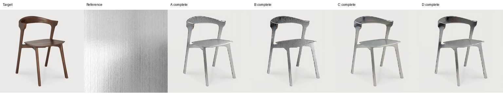
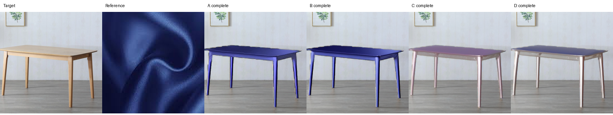
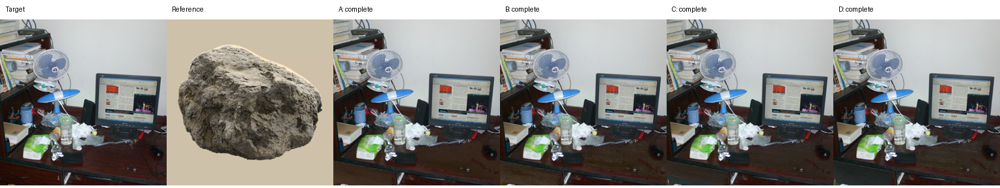

# 实验与消融分析（课程报告初稿）

本报告基于已完成的 96 次生成及对应评价结果。实验旨在分析参考图文本引导分割与文本—图像特征融合对材质迁移的影响，在改变目标区域外观的同时考察物体结构与背景的保留情况。所有结论均限定于当前小规模数据和单随机种子设置。

## 1. 数据与实验设置

实验包含 6 张家具目标图和 4 张材质参考图，进行全组合配对，共得到 24 对输入。目标图覆盖椅子、沙发和桌子，以及带有遮挡或杂物的场景；参考材质包括木材、金属、织物和石材。其中，木材、金属和织物参考为纹理特写，石材参考为孤立石块图。本轮没有设置多材质杂乱参考图，因此不能据此验证复杂参考图中的材质定位能力。

对每个目标预先固定编辑掩码和 DPT 深度图，四组方法共享相同输入。t06 的编辑对象为可见且未被遮挡的木质桌面与抽屉面板，不包含桌面上的杂物。目标掩码及参考区域标注由助手生成并进行目视检查，尚未经独立人工逐像素复核；用户对 t06 编辑对象的确认不等于像素标注验收。输入与文件摘要保存在 `data/course_fixed_v1/frozen_inputs.json`，避免不同组之间输入发生变化。

生成使用 SDXL、深度 ControlNet 和 IP-Adapter，输出分辨率为 1024×1024，随机种子统一为 42。配置步数为 30，strength 为 0.9999，对应实际 29 个去噪时间步。CFG scale 为 5.0，IP-Adapter scale 为 1.0，ControlNet scale 为 0.9，参考分割阈值为 0.5。四组共享通用正向提示词 `best quality, high quality` 及相同负向提示词；材质词用于启用的参考分割或融合分支。

实验在搭载 NVIDIA RTX 3060 Laptop GPU（6 GB 显存）的本地 Windows 机器上运行，采用 FP16、逐层 CPU 卸载、512 像素 VAE 分块和 batch size 4。软件环境包括 Python 3.10.9、PyTorch 2.5.1+cu124、Diffusers 0.32.2 和 Transformers 4.46.3。四组各生成 24 张图像，共 96 张，均已完成完整性检查。

## 2. 消融组设计

| 组别 | 文本引导参考分割 | 文本—图像特征融合 | 含义 |
|---|---|---|---|
| A | 关闭 | 关闭 | 基线：直接使用原参考图的图像条件 |
| B | 开启 | 关闭 | 在基线上加入 CLIPSeg 参考区域提取 |
| C | 关闭 | 开启 | 在基线上加入材质文本与参考视觉特征融合 |
| D | 开启 | 开启 | 同时使用两个模块的完整原型 |

参考分割由材质词引导 CLIPSeg 预测掩码，将掩码外区域替换为白色，保持原图尺寸，并非裁剪参考图。融合分支复用预训练 SDXL 的 Transformer block，处理 CLIP 视觉 token 和材质文本特征，再形成参考图像条件；该分支没有额外进行跨模态对齐训练。因此本实验评价的是当前融合原型，不能等同于充分训练后的融合方法上限。

B−A 与 D−C 分别考察在不使用和使用融合时加入分割的影响；C−A 与 D−B 分别考察在不使用和使用分割时加入融合的影响。四组均保留目标编辑掩码、去色预处理及深度控制，因此本轮不验证这些公共组件各自的贡献。

## 3. 评价协议

自动指标包括背景 MAE、背景 SSIM、背景 LPIPS、参考分割 IoU 和 CLIP 图像相似度。背景 MAE 在目标编辑掩码外计算，像素归一化至 [0,1]；SSIM 使用亮度通道，并排除统计窗口触及编辑前景的位置；LPIPS 将两张图的前景置为相同中性灰，再对背景距离图取均值。MAE 和 LPIPS 越低、SSIM 越高，表示背景保留越好。

CLIP 指标计算输出编辑区域包围框裁剪与原参考图之间的图像嵌入余弦相似度。它同时受到物体语义、颜色和形状影响，仅作为材质匹配的辅助指标。参考 IoU 只比较 B/D 的参考分割与独立于 CLIPSeg 生成的草稿区域标注，不衡量最终迁移质量。由于标注尚未独立复核，IoU 为暂定结果。

主观评价包含材质符合度、形状保留和自然程度三个维度，每项取 1–5 分，分数越高越好。当前共 1 名评分者、96 条完整评分。评分者此前查看过 AI 初评分，随后声明自行复核并保留全部分数，因此本轮按“AI 辅助人工复核”记录，不作为独立真人盲评或多人用户研究。

## 4. 定量结果

### 4.1 自动指标

| 方法 | 背景 MAE ↓ | 背景 SSIM ↑ | 背景 LPIPS ↓ | 参考 IoU ↑（草稿） | CLIP 相似度 ↑（辅助） |
|---|---:|---:|---:|---:|---:|
| A | 0.0082 | 0.9697 | 0.0281 | 不适用 | **0.7188** |
| B | 0.0082 | **0.9698** | 0.0284 | 0.9660 | 0.7145 |
| C | **0.0081** | 0.9697 | 0.0268 | 不适用 | 0.7094 |
| D | **0.0081** | **0.9698** | **0.0264** | 0.9660 | 0.7083 |

表中均值在 24 对输入上汇总，加粗依据显示精度，不能据此判断统计显著性。B/D 使用相同参考分割过程，IoU 相同不代表两组生成质量相同；同一参考图在多个目标上重复使用，独立参考仅 4 张。

四组的背景指标接近。D 的背景 LPIPS 最低，相比 A 降低约 0.0017；但背景保留无法反映编辑区材质是否正确。CLIP 相似度以 A 最高，D 最低，没有呈现随模块增加而上升的趋势。因此，自动指标不能支持“加入两个模块后全面改善”的结论。

### 4.2 AI 辅助人工复核

| 方法 | 材质符合度 ↑ | 形状保留 ↑ | 自然程度 ↑ |
|---|---:|---:|---:|
| A | 3.542 | 4.667 | 2.958 |
| B | **3.667** | 4.667 | 2.750 |
| C | 3.292 | **4.708** | 3.292 |
| D | 3.417 | **4.708** | **3.333** |

每组均为同一名评分者对 24 张结果的复核均值。B 的材质符合度最高，D 的自然程度最高，C/D 的形状保留均值略高。分数来源存在 AI 初评分依赖，不能将上述排序解释为独立人群偏好。

### 4.3 模块贡献与权衡

| 对比（候选−基线） | 材质符合度变化 | 形状保留变化 | 自然程度变化 |
|---|---:|---:|---:|
| B−A：加入分割 | +0.125 | 0.000 | −0.208 |
| D−C：融合基础上加入分割 | +0.125 | 0.000 | +0.042 |
| C−A：加入融合 | −0.250 | +0.042 | +0.333 |
| D−B：分割基础上加入融合 | −0.250 | +0.042 | +0.583 |

变化值从原始评分均值计算后四舍五入。当前复核结果中，参考分割在两种条件下均对应约 0.125 分的材质符合度提高，但自然程度的变化方向并不一致。融合分支对应更高的自然程度及略高的形状保留，同时材质符合度降低约 0.250 分。结合 CLIP 相似度下降，可以将这一现象描述为参考外观匹配与自然程度之间的权衡；不能仅凭这些指标断言其内部机制或因果原因。

## 5. 定性对比与失败案例

以下按原始 24 对输入中的编号展示三个说明性案例，列顺序为目标、参考、A、B、C、D。案例用于解释现象，并非随机抽样或替代完整结果统计。图片路径相对本报告所在的 `experiments` 目录。

### 5.1 椅子迁移金属材质：p002

四组均保留椅子的主要轮廓。A/B 的表面条纹较明显，B 的部分区域偏暗；C/D 的表面更平滑，但参考图中的拉丝纹理减弱。这一案例直观展示了纹理强度与表面自然程度可能不一致，不能将颜色变灰直接视为金属材质迁移成功。

### 5.2 桌子迁移织物材质：p011

A/B 较明显地迁移了参考的蓝色，C/D 的颜色变化较弱、偏灰紫；各组仍缺少清晰可辨的织物组织。桌子的总体几何形状得到保留，但颜色迁移强不等于织物质感成立。该案例说明仅依赖参考颜色或形状保留指标容易高估材质迁移质量。

### 5.3 杂乱桌面迁移石材：p024

桌面上的显示器、风扇和其他杂物整体保持，编辑集中在可见桌面区域。四组可见部分颗粒或粗糙纹理，但整体仍偏暗褐，与参考石块的颜色和大尺度纹理存在差距。该案例表明，在编辑面积受遮挡限制时，保留背景较好仍可能伴随材质变化不足。

## 6. 结论与局限

本轮实验完成了两个模块的四组消融。结果显示，参考分割对应更高的材质符合度复核均值，而当前未经额外训练的融合原型对应更高的自然程度均值，同时降低了材质符合度与 CLIP 相似度。D 在背景 LPIPS 和自然程度上表现较好，B 在材质符合度上表现较好，A 的 CLIP 相似度最高。因此，完整原型呈现多指标权衡，尚无证据表明其全面优于其他组。

实验存在以下限制：数据仅含 6 个目标与 4 个参考，24 对组合共享来源，不能视为 24 个独立来源样本；仅运行 seed=42，无法评估随机稳定性；参考图主要为纹理特写，缺少真正的多材质杂乱参考；目标掩码与参考区域为未独立复核的草稿；主观结果来自单人 AI 辅助复核；融合模块没有额外训练验证。基于这些限制，本报告仅给出描述性结果，不进行显著性或广泛泛化声明。

如需加强实验，优先补充真正独立的多名评分者与标注复核；随后加入多材质杂乱参考，并对代表性输入增加随机种子。若继续改进方法，应进一步验证融合特征的对齐与训练方式，而不是仅依靠增加模块数量推断性能提升。

## 7. 交付与复现索引

| 内容 | 仓库内路径 |
|---|---|
| 本轮配置 | `experiments/configs/local_6gb_1024_batch4.json` |
| 输入清单 | `data/course_fixed_v1/manifest.csv` |
| 冻结输入摘要 | `data/course_fixed_v1/frozen_inputs.json` |
| 全部 96 次运行记录 | `outputs/course-1024-batch4-v1/seed_42/{A,B,C,D}/{pair_id}/run.json` |
| 24 张完整对比图 | `outputs/course-1024-batch4-v1/comparisons/` |
| 自动指标原始值 | `outputs/course-1024-batch4-v1/metrics.csv` |
| 自动指标协议与汇总 | `outputs/course-1024-batch4-v1/metrics.summary.json` |
| 配对自动指标差值 | `outputs/course-1024-batch4-v1/evaluation/paired_deltas.csv` |
| 复核评分及来源声明 | `outputs/course-1024-batch4-v1/blind_review/rater_package/ratings.csv`、`ratings.provenance.json` |
| 复核评分汇总 | `outputs/course-1024-batch4-v1/human_ratings.json` |

向组员交付时应同时提供本报告及对比图目录，避免相对图片链接失效。正式提交前，请数据提供者补充图像来源与使用说明，并由小组核对方法介绍、参考文献及课程格式要求。本报告没有将待补充信息写为已完成事项。
