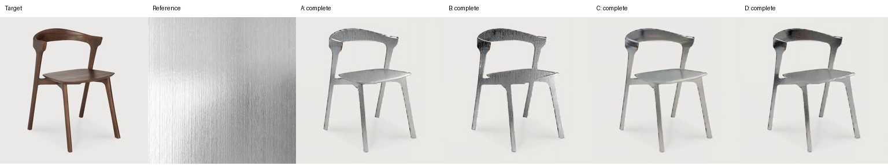
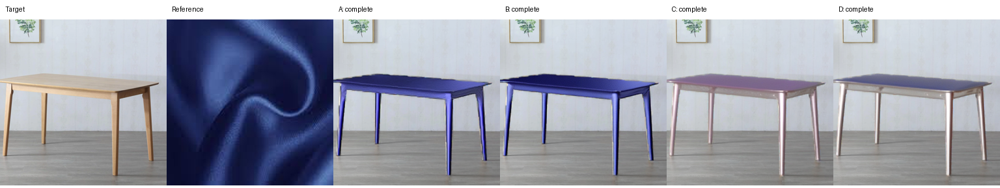
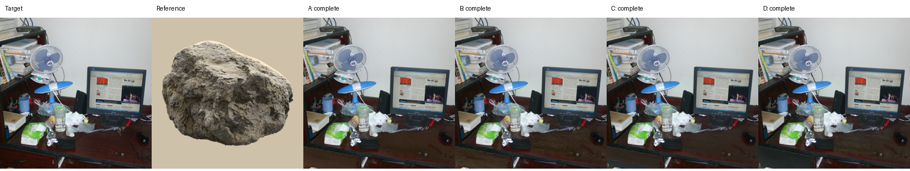

# Experiments and Ablation Analysis

Course report draft

This report presents the results of 96 completed material-transfer generations. The experiments examine how text-guided reference segmentation and text–image feature fusion affect material transfer, object structure, and background preservation. All findings are limited to the current small dataset and a single random seed.

## 1. Dataset and Experimental Setup

The dataset contains six target furniture images and four material reference images. Exhaustive pairing produces 24 target–reference pairs. The targets include chairs, sofas, and tables, with both relatively simple scenes and scenes containing clutter or occlusion. The reference materials are wood, metal, fabric, and stone. The wood, metal, and fabric references are texture close-ups, whereas the stone reference depicts an isolated rock. The dataset does not contain cluttered references with multiple materials and therefore does not evaluate material localization under that condition.

An editing mask and a precomputed DPT depth map are fixed for each target and shared across all four methods. For target t06, the editing region covers the visible, unoccluded wooden desktop and drawer front, excluding objects on the desk. Target masks and reference-region annotations are assistant-generated drafts that have been visually inspected but have not undergone independent human pixel-level verification. Confirmation of the intended object in t06 does not constitute validation of its pixel annotations. Frozen inputs and file hashes are recorded in `data/course_fixed_v1/frozen_inputs.json` to keep inputs consistent across methods.

Generation uses SDXL, a depth ControlNet, and IP-Adapter at a resolution of 1024×1024. The random seed is fixed at 42. The configuration specifies 30 steps and a strength of 0.9999, resulting in 29 denoising timesteps. The classifier-free guidance scale is 5.0, the IP-Adapter scale is 1.0, the ControlNet scale is 0.9, and the reference-segmentation threshold is 0.5. All methods share the positive prompt `best quality, high quality` and the same negative prompt. Material words are supplied to the reference-segmentation and/or fusion branches when those branches are enabled.

Experiments run locally on Windows with an NVIDIA RTX 3060 Laptop GPU with 6 GB of VRAM. Memory management uses FP16, sequential CPU offloading, 512-pixel VAE tiling, and a batch size of four. The software environment includes Python 3.10.9, PyTorch 2.5.1+cu124, Diffusers 0.32.2, and Transformers 4.46.3. Each method generates 24 images, yielding 96 outputs in total. All outputs have passed completeness checks.

## 2. Ablation Design

| Method | Text-guided reference segmentation | Text–image feature fusion | Description |
|---|---|---|---|
| A | Disabled | Disabled | Baseline using image conditioning from the original reference |
| B | Enabled | Disabled | Baseline with CLIPSeg reference-region extraction |
| C | Disabled | Enabled | Baseline with fusion of material-text and reference-visual features |
| D | Enabled | Enabled | Full prototype combining both modules |

Reference segmentation uses the material word to guide CLIPSeg. Pixels outside the predicted mask are replaced with white while preserving the original image dimensions; the reference is not cropped. The fusion branch reuses a pretrained SDXL Transformer block to process CLIP visual tokens and material-text features before constructing the reference-image conditioning. This branch has not received additional training for cross-modal alignment. Consequently, the experiment evaluates the current fusion prototype rather than the potential performance of a fully trained fusion method.

B−A and D−C measure the effect of adding segmentation without and with fusion, respectively. C−A and D−B measure the effect of adding fusion without and with segmentation. Target editing masks, decolorization preprocessing, and depth control are retained in every method, so their individual contributions are not evaluated here.

## 3. Evaluation Protocol

Automatic evaluation includes background MAE, background SSIM, background LPIPS, reference-segmentation IoU, and CLIP image similarity. Background MAE is computed outside the target editing mask with pixel values normalized to [0,1]. SSIM uses luminance and excludes locations whose statistical windows intersect the edited foreground. For LPIPS, the foreground of both images is replaced with the same neutral gray, after which the spatial distance map is averaged over the background. Lower MAE and LPIPS and higher SSIM indicate better background preservation.

CLIP similarity is the cosine similarity between image embeddings of the output's editing-region bounding-box crop and the original reference. Because it is affected by object semantics, color, and shape, it is used only as a proxy for material matching. Reference IoU compares the B/D segmentation masks against draft region annotations created independently of CLIPSeg; it does not measure final transfer quality. IoU results remain provisional because these annotations have not been independently verified.

Subjective assessment covers material match, shape preservation, and naturalness, each rated from 1 to 5, with higher scores indicating better results. There is one reviewer and 96 complete rating records. The reviewer had previously seen AI-generated initial ratings and subsequently reported reviewing the results and retaining all scores. These ratings are therefore documented as **AI-assisted human review**, rather than an independent human blind evaluation or a multi-participant user study.

## 4. Quantitative Results

### 4.1 Automatic Metrics

| Method | Background MAE ↓ | Background SSIM ↑ | Background LPIPS ↓ | Reference IoU ↑ (draft GT) | CLIP similarity ↑ (proxy) |
|---|---:|---:|---:|---:|---:|
| A | 0.0082 | 0.9697 | 0.0281 | N/A | **0.7188** |
| B | 0.0082 | **0.9698** | 0.0284 | 0.9660 | 0.7145 |
| C | **0.0081** | 0.9697 | 0.0268 | N/A | 0.7094 |
| D | **0.0081** | **0.9698** | **0.0264** | 0.9660 | 0.7083 |

Values are means over 24 input pairs. Bold entries indicate the best values at the displayed precision, not statistical significance. B and D use the same reference-segmentation procedure, so their identical IoU does not imply identical generation quality. References are reused across targets; there are only four distinct reference images.

Background metrics are similar across all methods. D achieves the lowest background LPIPS, approximately 0.0017 below A. However, background preservation does not establish material correctness within the edited region. CLIP similarity is highest for A and lowest for D, showing no monotonic improvement as modules are added. The automatic results therefore do not support a claim of improvement across all metrics from combining the two modules.

### 4.2 AI-Assisted Human Review

| Method | Material match ↑ | Shape preservation ↑ | Naturalness ↑ |
|---|---:|---:|---:|
| A | 3.542 | 4.667 | 2.958 |
| B | **3.667** | 4.667 | 2.750 |
| C | 3.292 | **4.708** | 3.292 |
| D | 3.417 | **4.708** | **3.333** |

Each method's scores are means over 24 outputs reviewed by the same person. B receives the highest material-match score, D receives the highest naturalness score, and C/D receive slightly higher shape-preservation scores. Since the ratings depend on AI-generated initial scores, these rankings should not be interpreted as independently measured population preferences.

### 4.3 Module Contributions and Trade-offs

| Comparison (candidate−baseline) | Change in material match | Change in shape preservation | Change in naturalness |
|---|---:|---:|---:|
| B−A: add segmentation | +0.125 | 0.000 | −0.208 |
| D−C: add segmentation with fusion | +0.125 | 0.000 | +0.042 |
| C−A: add fusion | −0.250 | +0.042 | +0.333 |
| D−B: add fusion with segmentation | −0.250 | +0.042 | +0.583 |

Differences are calculated from the original rating means before rounding. In the current review, adding reference segmentation is associated with a 0.125-point increase in material match under both conditions, while the direction of the naturalness change varies. The fusion branch is associated with higher naturalness and slightly higher shape preservation, alongside a 0.250-point decrease in material match. Together with the decrease in CLIP similarity, these observations suggest a trade-off between reference-appearance matching and naturalness. They do not establish the internal mechanism responsible for this behavior.

## 5. Qualitative Comparisons and Failure Cases

Three illustrative cases are identified by their original input-pair IDs below. Columns show the target, reference, A, B, C, and D, from left to right. These cases explain observed behavior; they are not a random sample or a substitute for the complete quantitative results. Image links are relative to the `experiments` directory containing this report.

### 5.1 Metal Transfer to a Chair: p002

All four methods preserve the chair's main silhouette. A/B produce more pronounced surface striations, with darker areas in B. C/D produce smoother surfaces, but the brushed texture in the reference becomes weaker. This example illustrates that stronger texture and greater apparent naturalness need not coincide. Changing the object to gray alone does not demonstrate successful metal transfer.

### 5.2 Fabric Transfer to a Table: p011

A/B transfer the reference's blue color more strongly, whereas C/D produce weaker, grayish-purple color changes. Clearly recognizable fabric structure remains limited across the outputs. The table's overall geometry is preserved, but strong color transfer does not establish convincing fabric appearance. This case shows why reference color or shape preservation alone can overestimate material-transfer quality.

### 5.3 Stone Transfer to a Cluttered Desktop: p024

The monitor, fan, and other objects are largely preserved, while edits remain concentrated on the visible desktop. Some granular or rough texture appears across the methods, but the surface remains dark brown and differs from the reference rock in color and large-scale texture. This case demonstrates that strong background preservation can coexist with insufficient material change when occlusion limits the editable region.

## 6. Conclusions and Limitations

The experiment completes a four-method ablation of two modules. Reference segmentation is associated with higher material-match review scores, while the current fusion prototype, without additional training, is associated with higher naturalness but lower material-match scores and CLIP similarity. D performs best on background LPIPS and reviewed naturalness, B performs best on reviewed material match, and A achieves the highest CLIP similarity. The full prototype therefore exhibits trade-offs across metrics; the available evidence does not establish consistent superiority over the other methods.

Several limitations constrain interpretation. The dataset contains only six targets and four references, and the 24 combinations share source images rather than representing 24 independently sourced samples. Only seed 42 is evaluated, so stochastic stability is unknown. Most references are texture close-ups, with no genuinely cluttered multi-material references. Target masks and reference annotations remain independently unverified drafts. Subjective scores come from one AI-assisted reviewer, and the fusion module has not undergone additional training validation. Accordingly, results are descriptive, with no claims of statistical significance or broad generalization.

To strengthen the evaluation, priorities are independent reviews from multiple raters and independent annotation verification, followed by cluttered multi-material references and additional random seeds for representative inputs. Further method development should investigate feature alignment and training of the fusion branch rather than assume that adding modules necessarily improves performance.

## 7. Deliverables and Reproducibility Index

| Item | Repository path |
|---|---|
| Experiment configuration | `experiments/configs/local_6gb_1024_batch4.json` |
| Input manifest | `data/course_fixed_v1/manifest.csv` |
| Frozen input hashes | `data/course_fixed_v1/frozen_inputs.json` |
| Records for all 96 runs | `outputs/course-1024-batch4-v1/seed_42/{A,B,C,D}/{pair_id}/run.json` |
| All 24 comparison sheets | `outputs/course-1024-batch4-v1/comparisons/` |
| Raw automatic metrics | `outputs/course-1024-batch4-v1/metrics.csv` |
| Automatic-metric protocol and summary | `outputs/course-1024-batch4-v1/metrics.summary.json` |
| Paired automatic-metric differences | `outputs/course-1024-batch4-v1/evaluation/paired_deltas.csv` |
| Review scores | `outputs/course-1024-batch4-v1/blind_review/rater_package/ratings.csv` |
| Rating provenance | `outputs/course-1024-batch4-v1/blind_review/rater_package/ratings.provenance.json` |
| Review-score summary | `outputs/course-1024-batch4-v1/human_ratings.json` |

Share the report together with the comparison-image directory while preserving their relative directory layout. Before formal submission, the data contributors should provide image sources and usage information, and the group should verify the method description, add bibliographic references, and apply the required course formatting. These outstanding items are not represented as completed in this draft.
